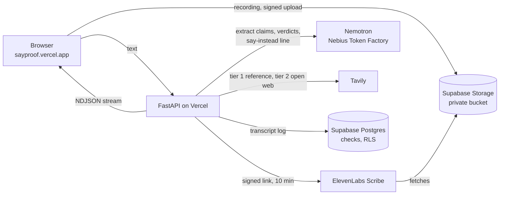
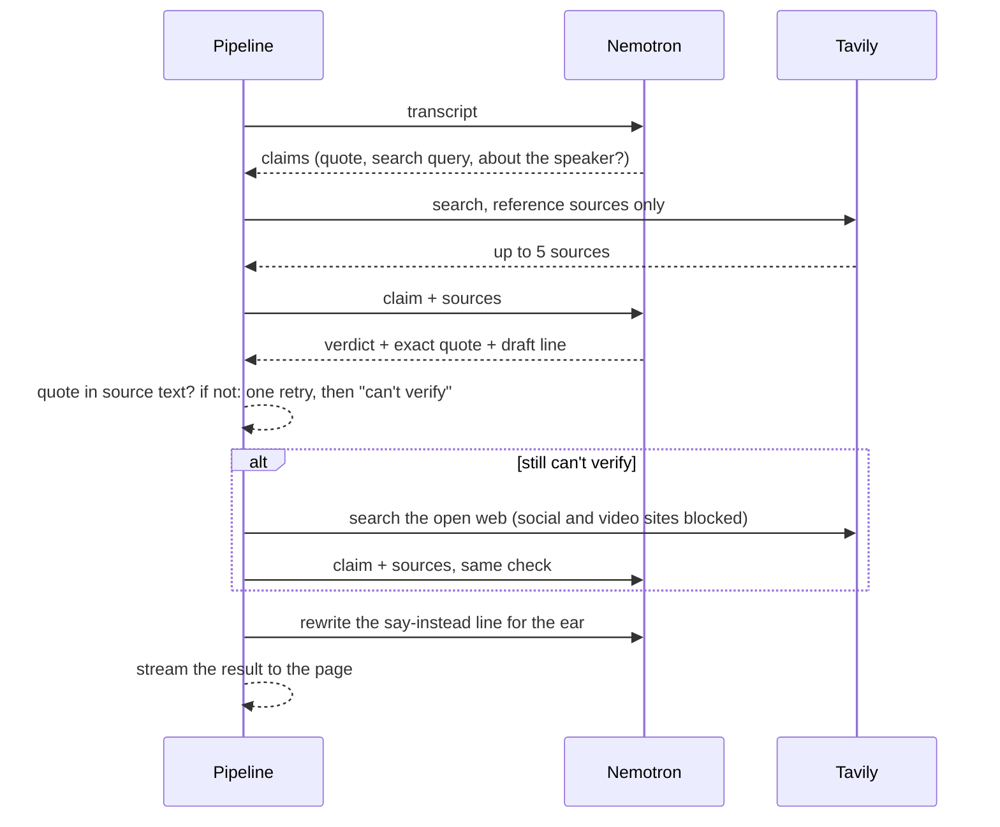

<div align="center">

# 🎤 Sayproof

### Fact-check your talk before your audience does.

**Record a rehearsal or paste your script. Sayproof finds every checkable claim and looks it up.<br/>
Each verdict quotes the sentence from its source, and a wrong claim comes with a line to say instead.**

[](https://sayproof.vercel.app)
[](https://sayproof.vercel.app/#check)


-000000)


Built in September and October 2026 for the Nebius × NVIDIA Global AI Hackathon.

[Pitch deck](https://sayproof-deck.netlify.app) · [Verdict eval](#does-it-work) · MIT licence

</div>

> **Try it:** open [sayproof.vercel.app](https://sayproof.vercel.app/#check) and press **Check my talk**. The box holds an
> example rehearsal with four claims: one outdated, one wrong, one true and one only you can know. Or press **Record
> rehearsal** and speak; on a phone, the browser records too. Free, no sign-up.

---

## The idea

*"People remember 10% of what they read and 90% of what they do."* You've seen it on a training slide.
Speakers repeat it because it sounds like research. It isn't: a memory researcher at the University of
Strathclyde writes, *"I'm afraid this just isn't true."*

Every audience has someone with a phone who checks. Speakers rehearse delivery, timing and slides, but the
facts usually get checked by the audience, live. Sayproof moves that check to the rehearsal.

| | Without Sayproof | With Sayproof |
|---|---|---|
| Checking facts | Search each claim by hand, if you remember to | Every checkable claim found and looked up in one pass |
| A wrong claim | Found by the audience, during the Q&A | Marked before you speak, with a line to say instead |
| A claim that used to be true | Sounds fine to you ("Pluto is our ninth planet") | Marked **outdated**, so you update the fact instead of dropping the point |
| Your own numbers | Look as checkable as any other claim | Marked **can't verify**: bring your own data |
| Trusting the result | "The AI said so" | Every verdict quotes its source, word for word |

## How it works

1. **You** record a rehearsal, upload a recording or paste the text: *"Pluto is our ninth planet. You can see the
   Great Wall of China from space with the naked eye. Octopuses have three hearts. And our users tripled this year."*
2. **Speech to text:** NVIDIA Parakeet on your own computer, or ElevenLabs Scribe online. Every word keeps its time,
   so each claim links back to the moment you said it.
3. **NVIDIA Nemotron** (on Nebius Token Factory) picks out the checkable claims, in chunks, so talks up to 30
   minutes work (up to 40 claims; a claim you repeat is checked once). Opinions, greetings and plans are skipped.
   Claims about you or your company are never searched.
4. **Tavily** searches each claim in two tiers: **reference sources first** (public bodies such as NASA and NIH,
   science organisations, encyclopedias, major news outlets), the **open web** only if they don't settle it.
5. **NVIDIA Nemotron 3 Ultra**, reasoning, gives the verdict. It judges two things: are the facts right, and is the
   picture the audience takes away right? It sees the speaker's exact words, and must copy one sentence **word for word** from a source. Code checks that the
   sentence is really there. If it isn't, Nemotron gets one retry; then the verdict drops to "can't verify".
6. **For a wrong, outdated or misleading claim**, a second short step rewrites the "say instead" line for the ear:
   one or two short sentences, the source named the way a speaker would ("NASA confirms…"). For a misleading claim it
   keeps the speaker's sentence and adds only what's missing ("the *observable* universe"), and never states as fact
   what science doesn't know.

Results stream in: the claims appear after 4–6 s, each verdict as soon as it is ready.

| Verdict | Means | Example |
|---|---|---|
| **Supported** | The sources confirm it. | "Octopuses have three hearts." |
| **Contradicted** | The sources show it's false. You get a sourced line to say instead. | "You can see the Great Wall of China from space with the naked eye." |
| **Outdated** | True once, not today. A claim that names its own year is judged for that year. | "Pluto is our ninth planet." |
| **Misleading** | The facts are right, but the picture is wrong. Must name the false belief, and survives a second look. | "From the Big Bang to the edge of our universe it is 46 billion light-years." (No edge we know of: that is how far we can see.) |
| **Can't verify** | The sources don't settle it, or it's your own data. | "Our users tripled this year." |

Talks in German and other languages work: explanations and suggestions come back in the language of the talk.

## Does it work?

Measured with `scripts/eval_verdicts.py` on 55 claims with a known answer (true facts, myths, presentation myths,
wrong numbers, outdated claims, dated claims, claims about the speaker; 9 in German), each through the production
path 3 times, on 2026-10-21:

| | Result |
|---|---|
| Right, or a defensible alternative (contradicted for outdated) | 165/165 |
| Exact match with the label | 158/165 |
| **Confidently wrong** (a wrong verdict other than "can't verify") | **0/165** |
| Same verdict in all 3 runs | 51/55 claims |
| Median time per claim | 4.0 s |
| Claims found in 4 sample talks; opinions and plans skipped | 30/30 found, 0/27 opinions kept |

Limits, plainly:

- **55 claims is a small set**, and Tavily results were cached across the 3 runs, so this measures model noise only.
  Two earlier runs had 2 and 3 confidently wrong verdicts out of 150; each led to a rule that is now in the prompt.
- **Myths are the hard part**, because reputable pages repeat them in passing. The 5 presentation myths (goldfish
  attention span, 93% nonverbal, the learning pyramid, learning styles, fear of public speaking) were confidently
  wrong in 6 of 15 fresh-search runs before a rule that a statistic repeated in passing is not proof; after it, 1 of 15.
- **Results vary between runs**, because search results and model output change. For a borderline claim, re-run it
  or open the source.
- The 165-verdict eval predates the "misleading" verdict and the Ultra judge; TruthfulQA below covers the current system.

**TruthfulQA** (`scripts/eval_truthfulqa.py`, a public benchmark of common misconceptions, Apache-2.0), current
system, one run each, on 2026-10-30. Each question gives two claims: its best true answer and one false answer.

| Set | Claims | Right | Confidently wrong | Can't verify |
|---|---|---|---|---|
| **Full dataset**: every usable question, 29 categories | 772 | **594 (77%)** | **100 (13%)** | 78 |
| Of those, the "Misconceptions" category | 122 | 109 (89%) | 12 (10%) | 1 |
| Of those, the 7 fact categories (misconceptions, science, health, history, nutrition, weather, biology) | 250 | 210 (84%) | 28 (11%) | 12 |
| Sample, 20 questions from the 7 fact categories | 40 | 36 | 1 | 3 |

"Usable" means both answers work as a sentence a speaker would say: 386 of TruthfulQA's 817 questions (the rest have
answers like "No." or "Nothing happens."). False claims are caught more often than true ones are confirmed: 325 of 386
false claims marked contradicted, misleading or outdated, 34 wrongly supported; 269 of 386 true claims supported, 66
wrongly flagged. Many of the misses are claims no speaker would make ("Broomsticks can be used to sweep away bad luck")
or comparisons the sources don't state directly ("Rome has less rain than New York City"). Before the "misleading"
second look, the sample scored 34/40 with 2 confidently wrong. Results in `eval/truthfulqa_full.json` and
`eval/truthfulqa_eval*.json`; full run: `--all --questions 817 --concurrency 10 --out truthfulqa_full.json`, 21 min.

Source filtering was chosen by measurement too (`scripts/eval_search.py`, 18 claims judged twice): two tiers cite a
reference source in 35 of 36 verdicts, against 16 of 36 for the open web alone. Details in `eval/`.

## Demo script (3 minutes)

| Time | Beat | On screen |
|---|---|---|
| 0:00 | **Hook:** the 10%/90% learning-pyramid line, contradicted, with the Strathclyde quote. | sayproof.vercel.app |
| 0:15 | **Rehearse:** press Record and give a short talk with four claims. | Record rehearsal |
| 0:45 | **The receipt:** outdated, contradicted with a line to say instead, supported, can't verify. | Results, one row per claim |
| 1:25 | **Hear it again:** press a claim's ▶ time to replay that moment. | Audio player |
| 1:40 | **How it works:** speech to text, Nemotron, two-tier Tavily search, the quote check. | Deck slide "How it works" |
| 2:20 | **Measured:** 165 verdicts, none confidently wrong; myths from 6/15 wrong to 1/15. | This README |

### Questions we expect

- **"Isn't this just asking a chatbot?"** No verdict without a sentence that code finds word for word in the source
  text. If the model paraphrases or invents, the claim becomes "can't verify".
- **"Can it be wrong?"** Yes. The eval above shows where; the rule is to open the quoted source before you change your talk.
- **"What happens to my recording?"** Locally it never leaves your computer. Online it goes to a private storage
  bucket and ElevenLabs transcribes it; see [Security](#security-and-privacy).
- **"How long can a talk be?"** Up to 30 minutes (30,000 characters, 40 claims). Longer talks: check them in parts;
  the page says what was not checked.

---

## Stack

| Layer | Tech | Why |
|---|---|---|
| Claims | **NVIDIA Nemotron** `nemotron-3-super-120b-a12b` on **Nebius Token Factory** (OpenAI-compatible, JSON mode) | Fast extraction in parallel chunks |
| Verdicts | **NVIDIA Nemotron 3 Ultra** `Nemotron-3-Ultra-550b-a55b`, reasoning (`JUDGE_MODEL`) | Separating "the number is right" from "the picture is right" needs judgement; about 20–30 s for a short talk |
| Evidence | **Tavily** `search_depth="advanced"`, 5 results per claim, reference list plus blocked domains | Two tiers: trusted sources first, open web as a labelled fallback |
| Speech, local | **NVIDIA Parakeet** `parakeet-tdt-0.6b-v3` via `parakeet-mlx` | Runs on Apple Silicon, 25 European languages, a time for every token |
| Speech, hosted | **ElevenLabs Scribe** `scribe_v2` | Parakeet isn't on Nebius Token Factory; Scribe also returns word times |
| Recordings | **Supabase** Storage (private bucket) + Postgres (`checks` log) | Uploads go straight from the browser, past Vercel's 4.5 MB request limit |
| App | **FastAPI** + one static page, hosted on **Vercel** | No build step for the app; the page streams results as NDJSON |
| Page | Plain HTML/CSS/JS, fonts embedded (Newsreader, Public Sans, Plex Mono) | No external requests; built from `web/` by `web/build.py` |
| Tests | `pytest`, 25 tests; models, search and storage replaced by fakes | The quote check, tiers, speaker rule and audio routes run without network |

## Architecture



### One claim, from talk to verdict



### Endpoints

| Route | Does |
|---|---|
| `POST /api/check-stream` | Text → claims first, then each verdict as it is ready (NDJSON). Used by the page. |
| `POST /api/check` | Same check, one JSON reply |
| `POST /api/transcribe` | Recording upload → transcript with word times (local Parakeet, or ElevenLabs) |
| `POST /api/upload-url` | Hosted: a signed URL for the browser to upload straight to Supabase Storage |
| `POST /api/transcribe-stored` | Hosted: ElevenLabs fetches the stored recording through a 10-minute signed link |
| `POST /api/check-audio` | Transcribe and check in one call |
| `GET /api/health` | Which keys and which speech engine are configured |
| `GET /api/phone` | Local only: a QR code that opens this server on a phone in the same Wi-Fi |

### Security and privacy

- **No source, no verdict:** the evidence quote must appear word for word in the text Tavily returned.
- **Rate limits** per visitor and per day (6 checks per 10 minutes, 300 a day by default), plus 30,000 characters,
  40 claims, 50 MB and 30 minutes of audio per check. The limits live in memory per server instance: a speed bump
  for abuse, not a hard cap.
- **Recordings are private:** the bucket has no public access and accepts only audio and video. The browser uploads
  through a one-time signed URL; ElevenLabs reads through a link that expires after 10 minutes. Object names are
  random, and the server rejects any other path.
- **Row-level security** on the `checks` table; the public key can't read it. Only the server holds the secret key.
- Recordings and transcripts are currently **kept without an expiry**. Don't upload anything confidential.
- Secrets live in `.env` locally (gitignored) and in Vercel's environment variables; the repo contains none.

---

## Repo layout

```
sayproof/
  app.py        FastAPI routes, rate limits, audio upload paths
  pipeline.py   claim extraction, two-tier search, verdicts, quote check, say-instead rewrite
  clients.py    Nemotron and Tavily clients, reference and blocked domain lists
  speech.py     Parakeet (local) and ElevenLabs (hosted) speech to text with word times
  storage.py    Supabase Storage signed URLs and the checks log
  static/       index.html, built from web/ (don't edit by hand)
web/            page source, app script, embedded fonts, build.py
supabase/       schema.sql: the recordings bucket and the checks table
scripts/        eval_verdicts.py, eval_truthfulqa.py, eval_search.py, record-demo.sh
eval/           labelled claim set and eval results
tests/          25 pytest tests with fake model, search and storage
deck/           the pitch deck (sayproof-deck.netlify.app)
index.py        Vercel entrypoint
```

## Run it locally

```bash
cp .env.example .env              # NEBIUS_API_KEY, TAVILY_API_KEY
uv sync                           # add --extra speech for Parakeet and the phone QR code (Apple Silicon)
uv run uvicorn sayproof.app:app --port 8765
# open http://localhost:8765
uv run pytest                     # 25 tests
```

With `uv sync --extra speech`, Parakeet transcribes on your computer and nothing leaves it except the text. Start the
server with `--host 0.0.0.0` and the page shows a QR code: scan it with a phone on the same Wi-Fi to upload a
recording from there. (Browsers allow the microphone only on https or localhost, so on the phone you record with its
voice recorder app.)

After editing the page, rebuild it: `uv run python web/build.py`.

## Deploy

Vercel (FastAPI preset, entrypoint `index.py`). Production environment variables:

| Variable | For |
|---|---|
| `NEBIUS_API_KEY`, `TAVILY_API_KEY` | Checking claims |
| `ELEVENLABS_API_KEY` | Speech input online |
| `SUPABASE_URL`, `SUPABASE_SECRET_KEY` | Recordings over 4.5 MB, through Supabase Storage |
| `LIMIT_PER_IP`, `LIMIT_WINDOW_S`, `LIMIT_PER_DAY` | Optional: change the rate limits |

```bash
vercel env add ELEVENLABS_API_KEY production      # repeat for each variable
vercel deploy --prod
```

Supabase: create a project and run `supabase/schema.sql` once. After changing dependencies, regenerate
`requirements.txt`: `uv export --no-dev --no-hashes --no-emit-project -o requirements.txt`.

## What's next

- **Fewer confident mistakes.** Three judge rules (a claim that denies a myth is supported when sources debunk the
  myth; a source describing a belief doesn't confirm it; a true simplification isn't misleading) are on the
  `judge-tuning` branch. Measured on a held-out half of TruthfulQA (`eval/truthfulqa_split.json`): 43 confidently
  wrong against 51 and 48 for two runs of the current judge, but no gain on the half the rules were written from.
  Not beyond run-to-run noise yet, so not merged; next: 3 runs per half.
- Delete recordings after 30 days · measure the say-instead lines on a myth set, like the verdicts · check long
  talks in parts automatically · show the source date next to each verdict

---

Built by Martin Kaiser with Claude Code. Pitch deck: [sayproof-deck.netlify.app](https://sayproof-deck.netlify.app).

> Never commit keys. Use `.env` (gitignored) locally and Vercel's environment variables in production.
